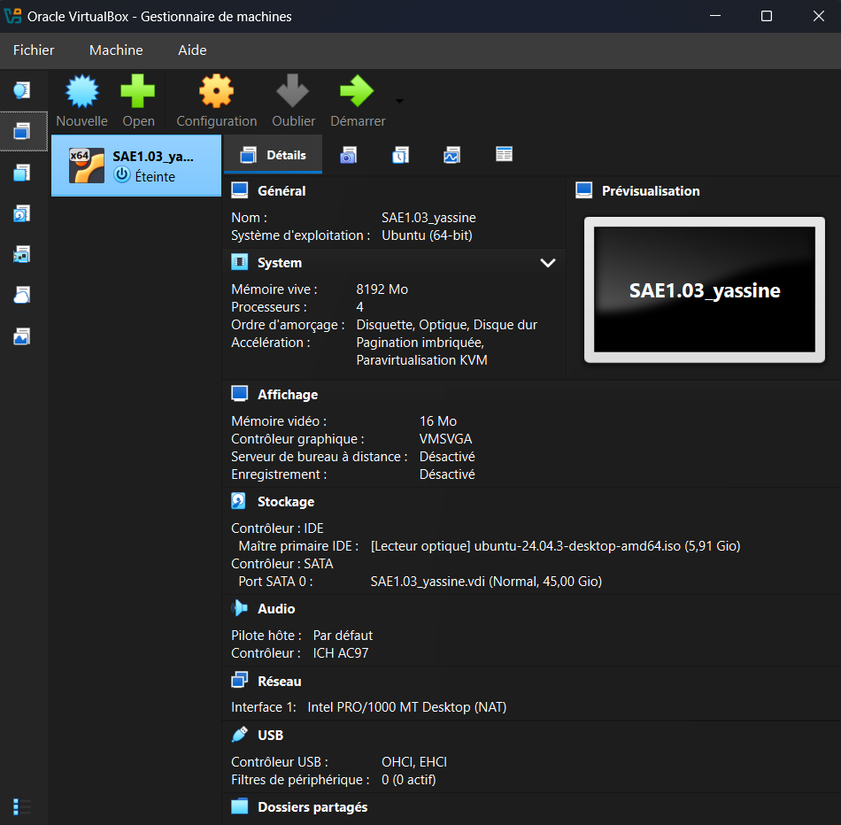
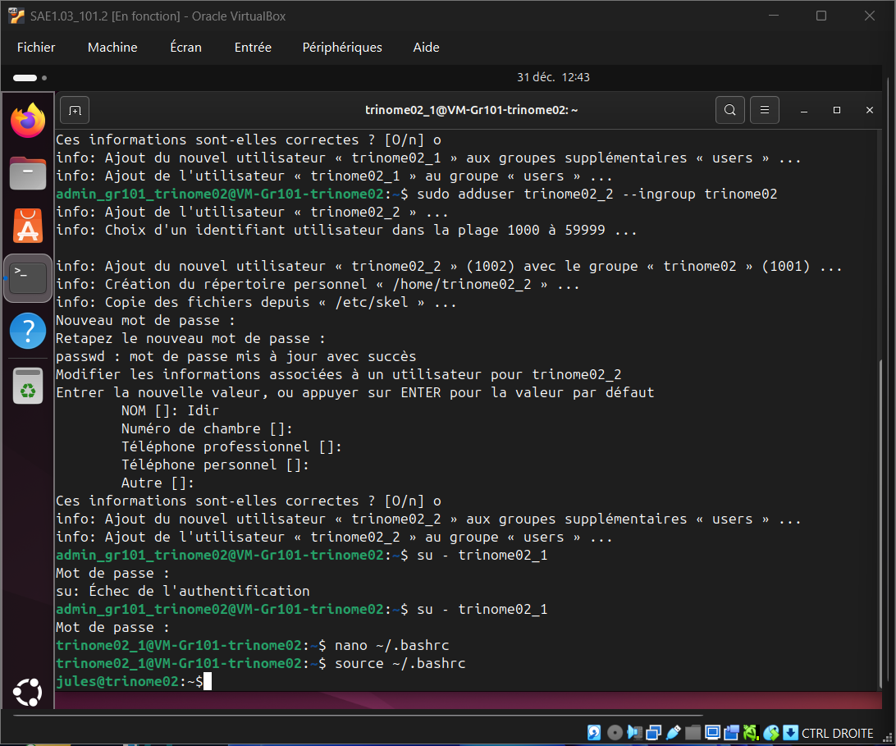
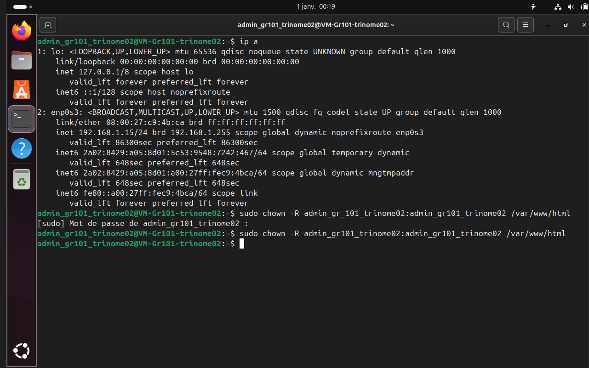

# Installation d'un poste de développement web (SAÉ 1.03)

Projet de 1re année de BUT Informatique à l'IUT Paris – Rives de Seine, réalisé en équipe de 3.

## Objectif

Partir de zéro : créer une machine virtuelle, la configurer et y héberger un site web fonctionnel.

## Mon rôle

Chef de projet et administrateur système.

## Ce qui a été fait

- Machine virtuelle sous **Ubuntu Server 24.04** avec VirtualBox (4 CPU, 8 Go de RAM)
- Création du compte administrateur, des utilisateurs et du groupe imposés par le sujet
- Personnalisation du terminal (`.bashrc`) pour distinguer le compte administrateur des comptes standards
- Installation du serveur web **Apache2** et correction d'un problème de droits sur `/var/www/html` avec `chown`
- Passage de la carte réseau en **mode pont** pour rendre le site accessible sur le réseau local
- Déploiement du site de l'équipe (Bootstrap 5) sur le serveur via **SFTP** depuis WebStorm

## Captures

| Machine virtuelle | Comptes utilisateurs | Adresse IP |
|---|---|---|
|  |  |  |

## Contenu du dépôt

Site de présentation du projet (`index.html`, `technique.html`, `equipe.html`, `style.css`) et captures d'écran des différentes étapes (`preuve_*.png`).

## Technologies

Linux (Ubuntu Server), VirtualBox, Apache2, Bash, SFTP, WebStorm
